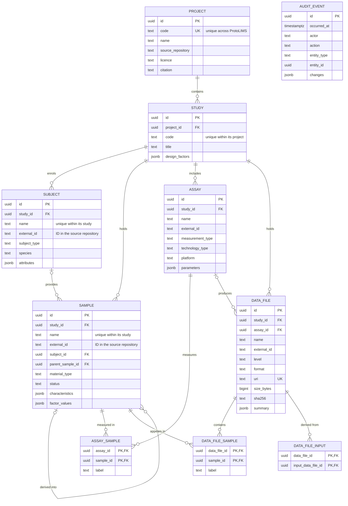

# Data model

ProtoLIMS uses a generic multi-omics model based on the ISA framework
(Investigation / Study / Assay), so that data from different repositories and
omics types fit the same structure.

## Entities

| ProtoLIMS   | ISA           | TCGA (GDC)                           | PRIDE (SDRF)       | LINCS L1000        |
| ----------- | ------------- | ------------------------------------ | ------------------ | ------------------ |
| Project     | Investigation | Program                              | Dataset (PXD…)     | Dataset (GSE…)     |
| Study       | Study         | Project (e.g. TCGA-BRCA)             | Dataset            | Phase / sub-study  |
| Subject     | Source        | Case                                 | Source name        | Cell line          |
| Sample      | Sample, Extract | Sample, Portion, Analyte, Aliquot  | Sample             | Treated well       |
| Assay       | Assay         | Experiment / read group              | Assay / MS run     | Plate / batch      |
| Data file   | Data file     | File                                 | Raw file / channel | Level 1–5 files    |

## Diagram

All tables also have `created_at`, `updated_at` and `created_by`.
An append-only `audit_event` table records who changed what, and when.

## Design decisions

- **IDs:** UUIDv7 primary keys (PostgreSQL 18 `uuidv7()`). The UUID is a
  record's permanent identity and is what links use; people work with codes and
  names.
- **Projects are independent.** Project codes are unique across ProtoLIMS.
  Everything else is scoped to its parent: study codes are unique within their
  project, and subject and sample names are unique within their study. So
  different projects can each have a `PILOT` study, and different studies can
  each have a sample called `S1`. Studies are addressed through their project,
  e.g. `/projects/TCGA-BRCA/studies/RNASEQ`.
- **No assumed identity across studies.** Two samples (or subjects) with the
  same name in different studies are separate records; ProtoLIMS assumes neither
  that they are the same nor that they are different. Connections between
  studies are made only by explicit, recorded links (planned): for example,
  "sample `S1` in study A is the same material as `TCGA-A1-A0SB-01A` in study
  B", with who made the link and on what basis (e.g. matched on a chosen
  column). A matching tool may suggest links, but nothing is linked until a
  person confirms it.
- **Single installation, single organisation:** ProtoLIMS is not designed for
  independent groups sharing one installation; projects provide separation
  within one organisation.
- **Cell lines** are Subjects with `subject_type = cell_line`; reference IDs
  (e.g. Cellosaurus) go in `attributes`.
- **Sample lineage:** one Sample table with `material_type` and a parent link
  covers multi-level chains (e.g. GDC sample → analyte → aliquot).
- **Metadata:** fixed columns for common fields; JSONB for type-specific
  `characteristics` (what a sample is) and `factor_values` (what was done to
  it), validated by Pydantic per type.
- **Data files** are stored in object storage, not the database. `uri` uses a
  scheme per backend (`r2://…`, `gs://…`), so storage can be R2, GCS or both.
- **Data files belong to a Study**; the Assay is optional, because analysis
  outputs may combine several assays.
- **Files can contain many samples** (e.g. TMT channels, matrix columns);
  `data_file_sample.label` records where each sample is within the file.
- **No hard deletes:** samples change `status` instead.
- **Audit trail:** recorded by the application (to revisit later).

## Demo data and licensing rules

- Use **open-access** data only; never controlled-access (e.g. dbGaP) data.
- Never attempt to re-identify individuals.
- Do not commit datasets to this repository; import scripts download from the
  official sources, and small processed subsets are kept in object storage.
- Every Project records its `licence` and `citation`, shown in the app.

Planned demo datasets: TCGA-BRCA RNA-seq (GDC, open access), CPTAC breast
cancer proteomics (PDC), a small LINCS L1000 subset (GEO), and optionally one
MetaboLights study.

## Deferred (not in the first week)

Storage locations (freezer/box/position), batches and plates, consent records,
protocols as a separate table, users and permissions beyond basic login,
explicit cross-study links for samples and subjects, and the matching tool that
suggests them.
